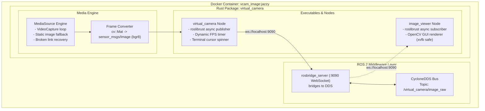
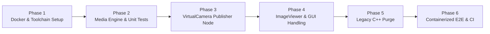

# Implementation Plan: Pure Rust Rewrite of `virtual_camera`

> **Repository:** `virtual_camera`  
> **Target Branch:** `jazzy_rust_devel`  
> **Middleware & OS:** ROS 2 Jazzy Jalisco on Ubuntu 24.04 LTS (`ros:jazzy-perception-noble`)  
> **Primary Technology Stack:** Rust 2021, `roslib-rust` (`roslibrust`), `tokio`, `opencv` (Rust bindings), Docker  

---

## 1. Executive Summary & Architectural Scope

This plan specifies the phased, complete replacement of the legacy C++14 implementation of `virtual_camera` with an idiomatic, asynchronous **Rust** implementation.

### Key Architectural Mandates
1. **Direct and Complete C++ Removal**:
   - All legacy C++ source files (`src/*.cpp`), headers (`include/virtual_camera/*.hpp`), and C++ GTest suites (`test/*.cpp`) will be completely deleted.
   - The package will transition to a Cargo-first workspace with clean integration into the ROS 2 container runtime.
2. **`roslib-rust` Dependency Integration**:
   - `roslibrust` (and companion crates `roslibrust_codegen_macro`) will be integrated as the ROS client library.
   - The Dockerfile will provide the Rust toolchain, build dependencies, and `ros-jazzy-rosbridge-server` to bridge between `roslibrust`'s async client and the ROS 2 CycloneDDS network.
3. **Container-First Testing**:
   - All verification steps—from unit tests to end-to-end topic validation and headless GUI verification—will be packaged to execute predictably inside Docker containers.

---

## 2. Target System Architecture



---

## 3. File Inventory: Additions, Modifications, and Deletions

### 3.1 Files to be Completely Removed
| Path | Reason for Removal |
| :--- | :--- |
| `include/virtual_camera/virtual_camera.hpp` | Replaced by `src/lib.rs` and `src/camera.rs`. |
| `include/virtual_camera/image_viewer.hpp` | Replaced by `src/viewer.rs`. |
| `include/virtual_camera/` | Directory deprecated. |
| `src/virtual_camera.cpp` | Replaced by `src/bin/virtual_camera.rs`. |
| `src/image_viewer.cpp` | Replaced by `src/bin/image_viewer.rs`. |
| `test/virtual_camera_test.cpp` | Replaced by `tests/camera_tests.rs`. |
| `test/image_viewer_test.cpp` | Replaced by `tests/viewer_tests.rs`. |

### 3.2 Files to be Added
| Path | Purpose |
| :--- | :--- |
| `Cargo.toml` | Rust package manifest specifying `roslibrust`, `tokio`, `opencv`, `clap`, and dev-dependencies. |
| `src/lib.rs` | Core crate library: `MediaSource`, frame decoding, ROS image converter, cursor spinner. |
| `src/camera.rs` | `VirtualCamera` node struct: async publish loop, FPS regulation, rosbridge connection. |
| `src/viewer.rs` | `ImageViewer` node struct: async image subscription, format decoding, window rendering. |
| `src/bin/virtual_camera.rs` | Main executable entrypoint supporting CLI arguments (`--fps`, `--use-image-viewer`, `--ws-url`). |
| `src/bin/image_viewer.rs` | Standalone viewer executable entrypoint. |
| `tests/camera_tests.rs` | Unit and component tests: media fallback, video EOF looping, message serialization. |
| `tests/viewer_tests.rs` | GUI subscriber tests using `xvfb-run`. |
| `scripts/run_container_tests.bash` | One-shot script to build Docker test container and execute the entire test battery. |
| `scripts/test_ros2_e2e.bash` | In-container script verifying active topic publication, message rate (Hz), and payloads. |

### 3.3 Files to be Modified
| Path | Modifications |
| :--- | :--- |
| `Dockerfile` | Add Rust toolchain, install `ros-jazzy-rosbridge-server`, build Rust binaries, configure entrypoint. |
| `package.xml` | Declare format 3 metadata with build and exec dependencies for Rust/Cargo. |
| `launch/showimageraw.launch.py` | Update node path to execute the compiled Rust binary with identical launch arguments. |
| `scripts/1_build_docker_image.bash` | Update tag and build options for Rust Docker container. |
| `scripts/2_create_docker_container.bash` | Support running the Rust node with GUI/X11 forwarding. |
| `ci.sh` | Replace C++ colcon test/lcov steps with Dockerized Cargo tests and E2E validation. |
| `AGENTS.md` & `README.md` | Update architectural reference, build instructions, and guidelines for Rust. |

---

## 4. Structured Phased Implementation

The implementation is structured into **6 sequential phases**. Each phase contains explicit tasks, deliverable artifacts, and strict verification checkpoints that must pass before advancing to the next phase.



---

### Phase 1: Toolchain, Dockerfile & Dependency Foundation

#### Objectives
Establish the Rust compilation environment inside the official `ros:jazzy-perception-noble` base image with `roslibrust` and ROS 2 bridging capabilities.

#### Detailed Tasks
1. **Update `Dockerfile`**:
   - Install Rust via `rustup` (1.85+ stable) with `cargo` and `rustc`.
   - Install build tools and libraries: `clang`, `libclang-dev`, `pkg-config`, `libssl-dev`, `xvfb`, `ros-jazzy-rosbridge-server`, `ros-jazzy-rmw-cyclonedds-cpp`.
   - Implement Docker layer caching for `Cargo.lock` and dummy sources (`src/lib.rs`) to prevent slow re-downloads of crates.
2. **Create `Cargo.toml`**:
   ```toml
   [package]
   name = "virtual_camera"
   version = "0.1.0"
   edition = "2021"
   license = "Apache-2.0"

   [dependencies]
   roslibrust = { version = "0.26", features = ["rosbridge", "codegen"] }
   roslibrust_codegen_macro = "0.26"
   tokio = { version = "1.38", features = ["full"] }
   opencv = { version = "0.93", default-features = false, features = ["imgcodecs", "videoio", "highgui", "imgproc"] }
   log = "0.4"
   env_logger = "0.11"
   clap = { version = "4.5", features = ["derive"] }

   [dev-dependencies]
   tokio-test = "0.4"
   ```
3. **Verify Message Codegen**:
   - Verify that `roslibrust_codegen_macro::find_and_generate_ros_messages!` accurately ingests `/opt/ros/jazzy/share/sensor_msgs` and `/opt/ros/jazzy/share/std_msgs` inside the container.

#### Verification Gate
- [ ] Docker image builds cleanly: `bash scripts/1_build_docker_image.bash`.
- [ ] Minimal Rust binary compiles and generates `sensor_msgs::msg::Image` struct definitions.

---

### Phase 2: Core Media Processing & Message Encoding Engine

#### Objectives
Port the media ingestion, looping, fallback logic, and ROS 2 message conversion from C++ to Rust (`src/lib.rs`).

#### Detailed Tasks
1. **Implement `MediaSource` in `src/lib.rs`**:
   - Logic to open `/data/input_data` with OpenCV `VideoCapture`.
   - If opening fails or invalid, fall back to `cv::imread` on `input_data`.
   - If image reading fails, fall back to `/data/nadezhda_diskant.jpg`.
   - Handle continuous video looping: when `cap.read(&mut frame)` yields empty frame at EOF, reset position / re-open stream.
2. **Implement Frame Conversion (`to_image_msg`)**:
   - Convert `cv::Mat` to `sensor_msgs::msg::Image`:
     - `header.stamp`: current time (ROS timestamp format).
     - `header.frame_id`: `"world"`.
     - `height`: `mat.rows() as u32`.
     - `width`: `mat.cols() as u32`.
     - `encoding`: `"bgr8"`.
     - `is_bigendian`: 0.
     - `step`: `(mat.cols() * 3) as u32`.
     - `data`: copied slice from `mat.data_bytes()`.
3. **Implement Terminal Cursor Spinner**:
   - Function `advance_cursor(pos: &mut usize)` printing `\rPublishing %c\b` through `['/', '-', '\\', '|']`.
4. **Author Unit Tests (`tests/camera_tests.rs`)**:
   - Test static image loading from symlink.
   - Test fallback to default image when symlink is broken.
   - Test video looping on EOF.
   - Validate dimensions and byte layout of converted `sensor_msgs::msg::Image`.

#### Verification Gate
- [ ] `docker run --rm vcam_image:jazzy cargo test --lib` passes 100% of unit tests.
- [ ] Video rewind and fallback logic proven without panic or memory leak.

---

### Phase 3: ROS 2 VirtualCamera Publisher Node

#### Objectives
Implement the standalone `virtual_camera` executable (`src/bin/virtual_camera.rs` & `src/camera.rs`) publishing to `/virtual_camera/image_raw` using `roslibrust`.

#### Detailed Tasks
1. **Implement `VirtualCamera` Struct (`src/camera.rs`)**:
   - Establish async connection via `roslibrust::ClientHandle::new(ws_url)`.
   - Advertise `/virtual_camera/image_raw` with topic queue size.
   - Setup `tokio::time::interval` ticking at `1000 / fps` ms.
   - Support dynamic frame rate updates via parameter or CLI flag.
2. **Executable Entrypoint (`src/bin/virtual_camera.rs`)**:
   - CLI flags via `clap`:
     - `--fps <int>` (default `24`).
     - `--ws-url <str>` (default `ws://localhost:9090`).
     - `--use-image-viewer` (boolean flag).
     - `--debug` (enables debug logging).
   - Graceful shutdown handling (`tokio::signal::ctrl_c`).
3. **Container Test Harness**:
   - Launch `rosbridge_server` inside container.
   - Run `virtual_camera` node.
   - Verify message publication via `ros2 topic echo /virtual_camera/image_raw --once`.

#### Verification Gate
- [ ] Topic `/virtual_camera/image_raw` visible in `ros2 topic list` over DDS.
- [ ] `ros2 topic hz /virtual_camera/image_raw` reports ~24 Hz.
- [ ] Carriage-return spinner animates in terminal during streaming.

---

### Phase 4: ROS 2 ImageViewer Subscriber & GUI Handling

#### Objectives
Implement the in-process and standalone `image_viewer` subscriber (`src/viewer.rs` & `src/bin/image_viewer.rs`), supporting various image encodings and headless execution.

#### Detailed Tasks
1. **Implement `ImageViewer` Subscriber (`src/viewer.rs`)**:
   - Subscribe to `/virtual_camera/image_raw`.
   - Decode incoming `sensor_msgs::msg::Image`:
     - Support encodings: `bgr8`, `rgb8`, `mono8`, `rgba8`, `bgra8`, `mono16`, `32FC1`.
     - Convert `rgb8` to `bgr8` for OpenCV display.
   - Render image using `opencv::highgui::imshow("image_viewer", &mat)` and `wait_key(1)`.
2. **Implement Standalone Binary (`src/bin/image_viewer.rs`)**:
   - Standalone viewer connecting to `/virtual_camera/image_raw`.
3. **In-Process Pipeline Support**:
   - When `--use-image-viewer` is passed to `virtual_camera`, spawn `ImageViewer` in a concurrent Tokio task without serialization overhead.
4. **Headless Safety**:
   - Author headless test in `tests/viewer_tests.rs` executed under `xvfb-run -a cargo test --test viewer_tests`.

#### Verification Gate
- [ ] Standalone `image_viewer` displays video frames in desktop environment with X11 forwarding.
- [ ] Headless test under `xvfb-run` completes inside Docker container with zero GUI crashes.

---

### Phase 5: Complete C++ Deprecation & Workspace Cleanup

#### Objectives
Purge all legacy C++ code, headers, build definitions, and unused artifacts from the repository.

#### Detailed Tasks
1. **Remove C++ Files**:
   - `git rm -r include/`
   - `git rm src/virtual_camera.cpp src/image_viewer.cpp`
   - `git rm test/virtual_camera_test.cpp test/image_viewer_test.cpp`
2. **Update Build Configuration**:
   - If using pure Cargo inside Docker: simplify `package.xml` and replace `CMakeLists.txt` with Cargo installation step, or use `corrosion` / `colcon-cargo` if ROS 2 workspace overlay integration is desired.
   - Ensure compiled binaries are installed to standard paths (`/usr/local/bin` or ROS 2 install directory).
3. **Update Launch File (`launch/showimageraw.launch.py`)**:
   - Point executable execution to the compiled Rust binary `virtual_camera`.
   - Forward `use_image_viewer` and `use_debug` flags as CLI parameters.

#### Verification Gate
- [ ] Zero C++ files (`.cpp`, `.hpp`) remain in the repository.
- [ ] Workspace clean build succeeds using only Cargo and Docker.

---

### Phase 6: Containerized Testing Suite, Scripts & CI Integration

#### Objectives
Deliver comprehensive, automated containerized testing and update repository documentation and helper scripts.

#### Detailed Tasks
1. **Container Test Runner (`scripts/run_container_tests.bash`)**:
   - Script builds the Docker container.
   - Runs `cargo test --all-targets` inside the container.
   - Runs `xvfb-run -a cargo test --test viewer_tests` inside the container.
   - Spins up `rosbridge_server` and `virtual_camera` in the background, executes `scripts/test_ros2_e2e.bash`, checks topic hz, verifies payload, and reports overall test status.
2. **Update Helper Scripts**:
   - `scripts/1_build_docker_image.bash`: builds production Rust container.
   - `scripts/2_create_docker_container.bash`: runs container with `xhost` and `ros2 launch virtual_camera showimageraw.launch.py use_image_viewer:=true`.
   - `scripts/change_fps.bash`: calls node CLI/param to change FPS dynamically.
3. **Update CI Workflows**:
   - Modernize `.github/workflows/industrial_ci_action.yml` and `ci.sh` to trigger containerized test runner.
4. **Documentation**:
   - Update `README.md` and `AGENTS.md` reflecting pure Rust architecture, Docker commands, and contributor guidelines.

#### Verification Gate
- [ ] `bash scripts/run_container_tests.bash` succeeds with exit code 0.
- [ ] `bash scripts/2_create_docker_container.bash` streams live video with GUI viewer on host.
- [ ] CI workflow passes in GitHub Actions / Docker environment.

---

## 5. Risk Management & Mitigations

| Risk | Impact | Mitigation Strategy |
| :--- | :--- | :--- |
| **`rosbridge_server` startup latency** | Node might fail to connect if rosbridge is not ready. | Implement exponential backoff retry in `VirtualCamera::connect` (e.g. up to 10 attempts at 500 ms intervals). |
| **OpenCV Rust build duration in container** | Docker build takes too long compiling OpenCV bindings. | Cache cargo dependencies via multi-stage Docker build or mount cargo cache volume during development. |
| **Headless test crash in CI** | OpenCV HighGUI aborts when `DISPLAY` is not found. | Wrap tests inside `xvfb-run -a` and allow an environment variable `VCAM_HEADLESS=1` to bypass `imshow` in CI assertions. |
| **Data asset path resolution** | Binaries cannot locate `data/input_data` if executed from non-root directories. | Resolve path relative to executable or `CARGO_MANIFEST_DIR`, with fallback to `/virtual_camera_ws/src/virtual_camera/data`. |

---

## 6. Execution Checklist

- [ ] **Phase 1**: Toolchain, Dockerfile & Dependency Foundation
- [ ] **Phase 2**: Core Media Engine & Message Conversion (with Unit Tests)
- [ ] **Phase 3**: ROS 2 VirtualCamera Publisher Node (with roslibrust)
- [ ] **Phase 4**: ROS 2 ImageViewer Subscriber & GUI Handling (with xvfb)
- [ ] **Phase 5**: Complete C++ Code Deprecation & Workspace Purge
- [ ] **Phase 6**: Containerized E2E Testing, Helper Scripts & CI Integration
